# **TEMA 2**

# Tarea 2.2

### Descargar Imagenes

#### Ubuntu:

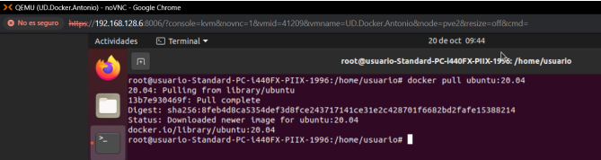

#### mysql

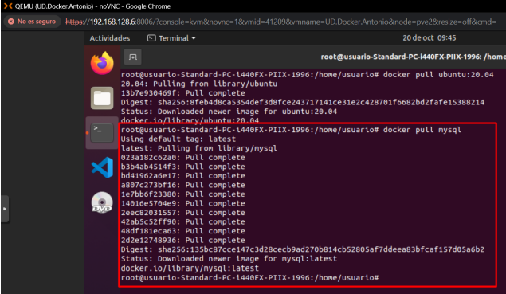

#### httpd

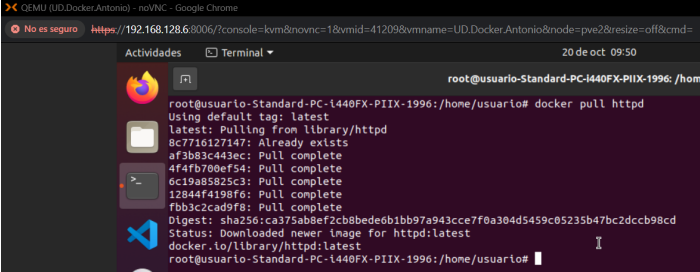

#### php

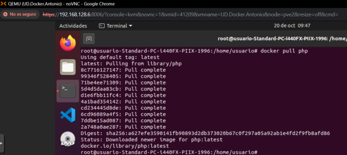

#### centos

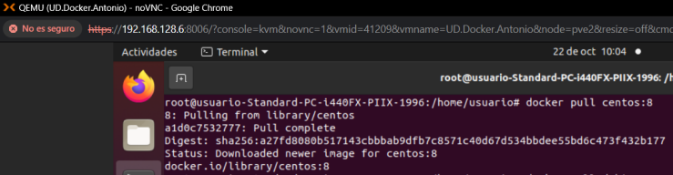

#### debian

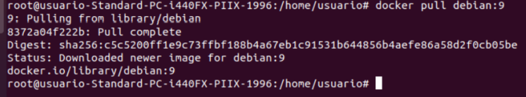
#### mariadb

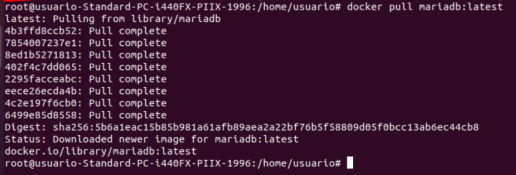

#### tomcat

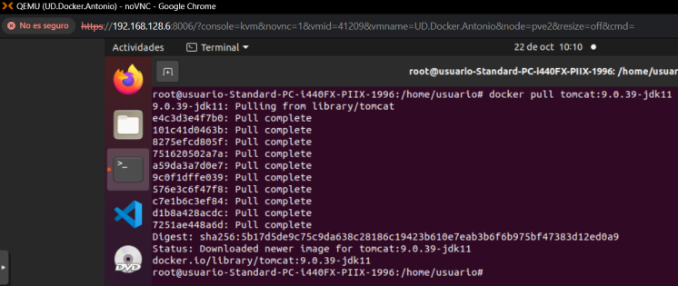

#### jenkins

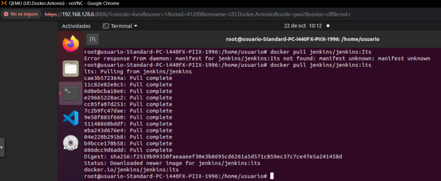

#### Comprobar que estan todas descargadas:

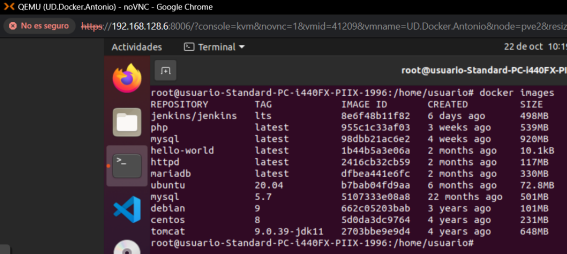

# Tarea 2.3
### Arrancar un contenedor de la imagen ubuntu:18.04 al que llamaremos ubuntu. Una vez arrancado realizar las siguiente operaciones

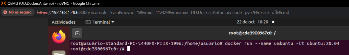

### Salir del contenedor y capturar un pantallazo donde se pueda comprobar que ese
contenedor se ha parado

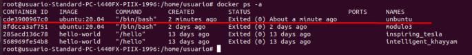

### Rearrancar el contenedor desde tu equipo y capturar un pantallazo donde se pueda
comprobar que está funcionando

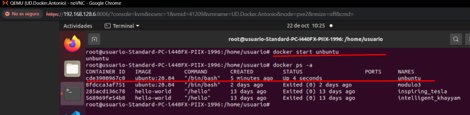

### Sin entrar en el contenedor, mostrar por pantalla el fichero /etc/os-release y capturar un
pantallazo del resultado

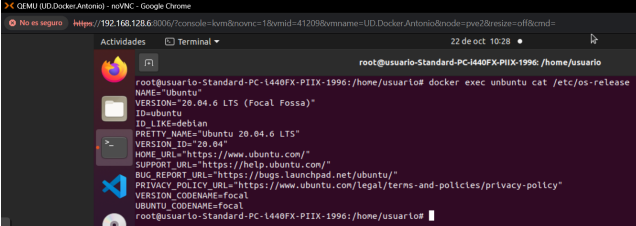

# Tarea 2.4
### Arranca un contenedor que ejecute una instancia de la imagen php:7.3-apache, que se llame web y que sea accesible desde tu equipo en el puerto 8181

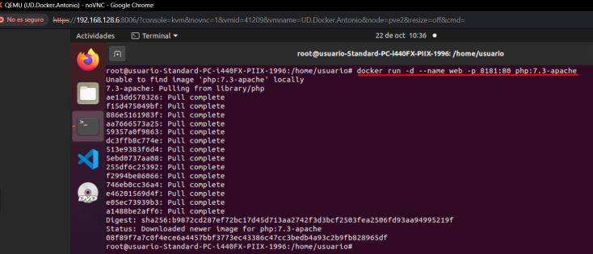

### Colocar en el directorio raiz del servicio web de dicho contenedor un fichero llamado index.html con el siguiente contenido:
```html
<h1>HOLA SOY TUNOMBRE</h1>
```

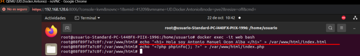

### Colocar en ese mismo directorio raiz un archivo llamado index.php con el siguiente contenido:
```php
<?php phpinfo(); ?>
```

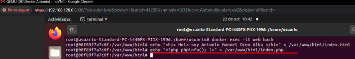

### Arrancar un contenedor que se llame bbdd y que ejecute una instancia de la imagen mariadb para que sea accesible desde el puerto 3336.

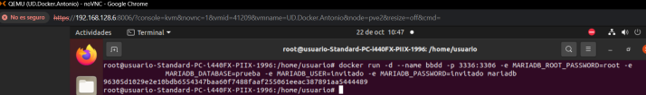

#### Comprobacion del index

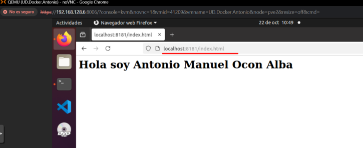
#### Comprobacion php

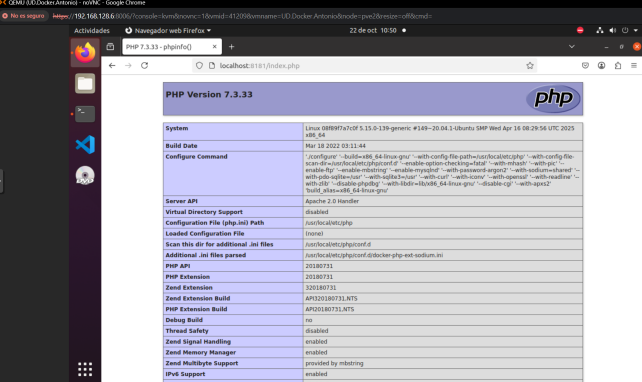

#### Ultima comprobacion

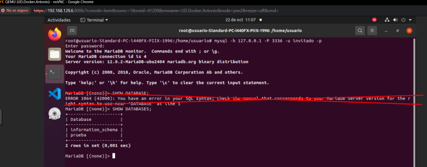

# Tarea 2.5

### Partiendo de los contenedores en ejecución de la tarea anterior y ejecutando la orden de docker cli adecuada obtener la siguiente información realizando un pantallazo cada vez:

#### Dirección IP del contenedor web

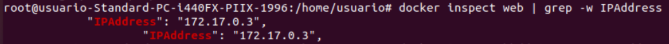
#### Redirección de puertos del contenedor web

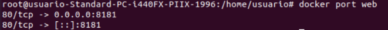
#### Dirección IP del contenedor bbdd

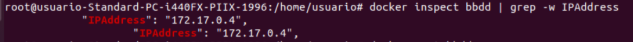
#### Redirección de puertos del contenedor bbdd

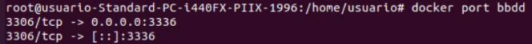

# **TEMA 3**

# Tarea 3.2

### 1. Descargar una nueva imagen desde Docker Hub, la imagen Ubuntu:20.04.

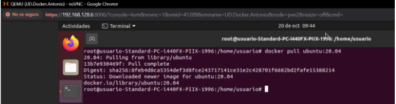
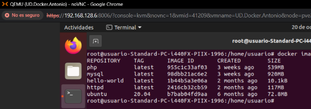

### 2. Obtener toda la información de esa imagen y volcarla en el fichero info.txt.

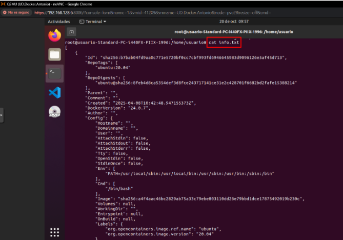

### 3. Instanciar esa imagen creando un contenedor llamado modulo3.

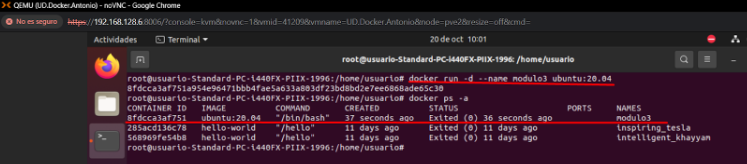

### 4. Intentar borrar la imagen Ubuntu:20.04. ¿Has podido borrar la imagen? Responde razonadamente.

No se puede borrar la imagen mientras exista un contenedor creado a partir de ella, aunque el contenedor no esté en ejecución. Que el contenedor esté parado no significa que haya dejado de depender de la imagen.

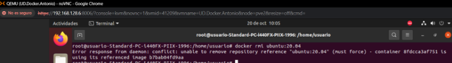

### 5. Realizar las operaciones necesarias para poder borrar la imagen.

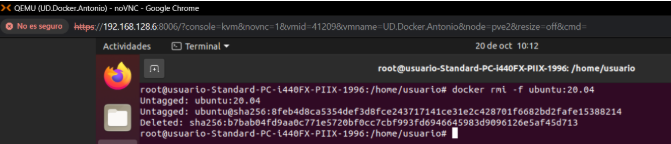

